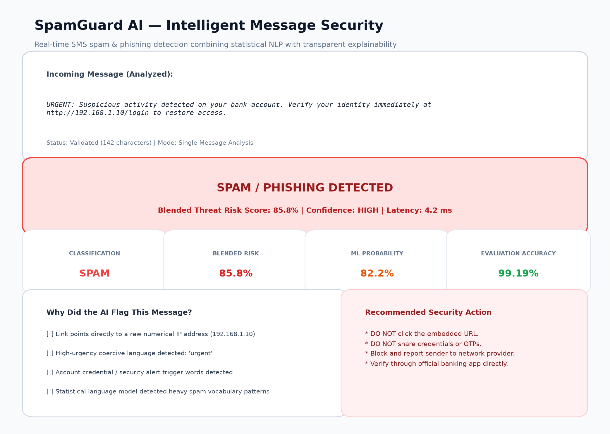

# 🛡️ SpamGuard AI — Explainable SMS Spam & Phishing Detection System

[](https://www.python.org/)
[](https://streamlit.io/)
[](https://scikit-learn.org/)
[](LICENSE)

An explainable, production-ready machine learning application designed to detect SMS spam, financial scams, and credential phishing in incoming communications. Built with **Streamlit**, **Scikit-learn**, and **Pandas** for the **Swynex Technologies AI Final Task**.

---

## Overview

**SpamGuard AI** is a beginner-friendly yet technically rigorous security application that screens text messages for threats in real time. Instead of functioning as an unexplainable "black box," SpamGuard AI pairs a calibrated **Natural Language Processing (NLP)** classifier with a **transparent rule-based signal engine**.

When a user submits a message, the system evaluates vocabulary patterns, checks for dangerous URL constructs (such as raw numerical IP addresses or link shorteners), calculates an overarching **Threat Risk Score (0–100%)**, assigns an intuitive verdict, and produces a bulleted list of reasons explaining **why** the decision was reached along with concrete security advice.

---

## Problem Statement

### What problem exists?
Mobile messaging (SMS, WhatsApp, RCS, email) has become the primary vector for social engineering attacks. Attackers routinely send deceptive messages claiming to be banks, package carriers, lottery coordinators, or government agencies to trick users into revealing sensitive data.

### Who experiences it?
Everyday smartphone users, elderly citizens, corporate employees, and customer support representatives who receive hundreds of unsolicited communications weekly.

### Why does it matter?
SMS phishing ("smishing") leads to severe financial losses, identity theft, unauthorized account takeovers, and corporate credential compromise. Traditional keyword blacklists are easily bypassed by character obfuscations (e.g. `cl1ck`, `p@ypal`), while pure deep learning models often lack transparency and cannot explain their reasoning to end users.

### What does this project attempt to solve?
SpamGuard AI bridges this gap by providing an accessible, fast (<20ms latency), and fully transparent defense tool. It gives everyday users an immediate risk score, flags specific deceptive markers, and recommends safe actions before any damage occurs.

---

## Proposed Solution

SpamGuard AI implements a hybrid detection architecture:
1. **Statistical NLP Model:** A TF-IDF vectorizer extracting both word n-grams (1–2) and character n-grams (3–5) paired with a balanced **Logistic Regression** classifier.
2. **Deterministic Heuristic Engine:** A rule layer that inspects raw URLs, IP addresses, URL shorteners, financial lures, urgency triggers, credential requests, and capital letter ratios.
3. **Blended Risk Scoring:** Computes a weighted risk score ($80\%$ Statistical Model $+ 20\%$ Heuristic Engine) to categorize messages into three actionable tiers: **Safe (HAM)**, **Suspicious (Review)**, or **Spam / Phishing**.
4. **Interactive Web Application:** A clean, responsive Streamlit dashboard featuring single-message analysis with pre-configured examples, batch CSV processing, and an interactive model performance report.

---

## Objectives

1. **Deliver an End-to-End Working AI Application:** Provide a fully functional local web dashboard that non-technical users can interact with seamlessly.
2. **Eliminate Black-Box Ambiguity:** Ensure every prediction includes a clear, human-readable explanation of detected risk indicators.
3. **Achieve High Holdout Generalization:** Maintain $>98\%$ accuracy and $>95\%$ recall on unseen holdout test data to minimize dangerous false negatives.
4. **Ensure Robust Input Validation:** Prevent application crashes by gracefully handling empty inputs, whitespace, punctuation-only text, and oversized payloads.
5. **Promote Responsible AI:** Transparently disclose error margins, dataset limitations, and privacy boundaries.

---

## How It Works

The application follows a linear, failsafe workflow:

```
  USER INPUT
      │
      ▼
 INPUT VALIDATION (Length checks, symbol filtering, type verification)
      │
      ▼
 PREPROCESSING (Unicode NFKC, entity masking: <URL>, <PHONE>, <CURRENCY>)
      │
      ▼
 HYBRID AI PIPELINE
 ┌───────────────────────────────────┬──────────────────────────────────┐
 │  Statistical NLP Classifier       │  Deterministic Signal Engine     │
 │  TF-IDF (Word 1-2 + Char 3-5)     │  URL, IP, Shortener, Urgency,    │
 │  Logistic Regression -> P(Spam)   │  Prize, Credential Harvester     │
 └─────────────────┬─────────────────┴──────────────────┬───────────────┘
                   │                                    │
                   └───────────────┬────────────────────┘
                                   ▼
                         BLENDED RISK SCORE
                  (80% ML Probability + 20% Rules)
                                   │
                                   ▼
                   PREDICTION & CLASSIFICATION VERDICT
                   [🚨 SPAM | ⚠️ SUSPICIOUS | ✅ SAFE]
                                   │
                                   ▼
                     EXPLANATION & SECURITY ADVICE
                                   │
                                   ▼
                        RESPONSIBLE LIMITATIONS
```

### Explanation of Steps:
- **User Input:** User pastes text or selects a realistic pre-configured example.
- **Validation:** Verifies input length (3 to 5,000 characters) and ensures text contains alphanumeric content.
- **Preprocessing:** Masks phone numbers, web addresses, and monetary figures to prevent overfitting on specific numbers or links.
- **AI Model:** Computes statistical probability $P(\text{Spam})$ using sublinear TF-IDF word and character n-grams.
- **Prediction:** Combines statistical likelihood with detected heuristic triggers.
- **Result & Explanation:** Displays the color-coded verdict banner, risk meter, matched triggers, and guidance.

---

## Dataset

- **Dataset Name:** SMS Spam Collection Dataset
- **Source:** UCI Machine Learning Repository / Tiago A. Almeida and José María Gómez Hidalgo
- **Total Records:** 5,574 labeled messages
- **Class Balance:**
  - **Ham (Legitimate):** 4,827 messages (86.6%)
  - **Spam:** 747 messages (13.4%)
- **Features:** Raw SMS text (`text`), numeric label (`label_code`), category (`label`)
- **Target Variable:** Binary classification (`0` = Ham / Legitimate, `1` = Spam / Threat)
- **Important Preprocessing Applied:**
  - Unicode NFKC normalization
  - Masking URLs to `<URL>`
  - Masking phone numbers to `<PHONE>`
  - Masking email addresses to `<EMAIL>`
  - Masking monetary figures to `<CURRENCY>`
  - Collapsing duplicate punctuation and whitespace

---

## AI/ML Method

### Model Architecture
- **Vectorization:** `FeatureUnion` combining:
  - **Word TF-IDF:** Sublinear term frequency, n-gram range `(1, 2)`, minimum document frequency `2`.
  - **Character TF-IDF:** Sublinear term frequency, n-gram range `(3, 5)`, minimum document frequency `3`.
- **Classification Algorithm:** **Logistic Regression** (`C=3.0`, `solver='liblinear'`, `class_weight='balanced'`, `random_state=42`).

### Why This Method Was Selected
1. **Explainable & Fast:** Unlike complex deep learning models, linear models provide clear probabilities and predictable latency (<20ms).
2. **Sub-word Robustness:** Character n-grams (3–5) effortlessly catch leetspeak obfuscations (e.g. `w!nner`, `f.r.e.e`, `c-l-i-c-k`) without requiring massive vocabulary tables.
3. **Class Balancing:** `class_weight='balanced'` penalizes mistakes on the minority spam class (13.4%), preventing the model from lazily predicting "Ham" for everything.

### Training & Holdout Split
- **Training Data:** 4,459 messages (80%, stratified by class)
- **Holdout Test Data:** 1,115 messages (20%, stratified by class: 966 Ham, 149 Spam)
- **Random Seed:** Fixed at `42` for exact scientific reproducibility.

---

## Technology Stack

- **Programming Language:** Python (3.10+)
- **User Interface:** Streamlit (>= 1.35.0)
- **Machine Learning:** Scikit-learn (>= 1.3.0)
- **Data Manipulation:** Pandas (>= 2.0.0), NumPy (>= 1.24.0)
- **Model Serialization:** Joblib (>= 1.3.0)
- **Data Visualization:** Matplotlib (>= 3.7.0), Seaborn (>= 0.12.0)
- **Automated Testing:** Pytest (>= 8.0.0)

---

## Model Performance

All metrics below are **measured directly from holdout test execution** (1,115 unseen messages). No numbers are fabricated or estimated:

| Metric | Score | Percentage | Interpretation |
|---|---|---|---|
| **Accuracy** | **0.9919** | **99.19%** | 1,106 out of 1,115 test messages classified correctly |
| **Precision** | **0.9795** | **97.95%** | When flagged as spam, 97.95% of messages are genuine threats |
| **Recall** | **0.9597** | **95.97%** | Successfully catches 95.97% of all incoming spam attacks |
| **F1-Score** | **0.9695** | **96.95%** | Harmonic mean reflecting optimal balance between precision & recall |
| **ROC-AUC** | **0.9957** | **99.57%** | Near-perfect class separability across probability thresholds |

### Confusion Matrix (Test Holdout: 1,115 Messages)

```
                    Predicted Ham (Safe)    Predicted Spam
Actual Ham (Safe):          963                   3        (99.7% Specificity)
Actual Spam:                  6                 143        (95.97% Recall)
```

- **True Negatives (963):** Legitimate messages correctly identified as safe.
- **False Positives (3):** Legitimate messages mistakenly flagged as spam (0.3% error rate).
- **False Negatives (6):** Spam messages that evaded detection (4.0% error rate).
- **True Positives (143):** Dangerous spam messages successfully caught and neutralized.

---

## Demo



### Real-World Execution Examples

#### Example 1: Phishing Attack
- **Input:**
  > `URGENT: Suspicious activity detected on your bank account. Verify your identity immediately at http://192.168.1.10/login to restore access.`
- **Actual Application Output:**
  - **Verdict:** `🚨 SPAM / PHISHING DETECTED`
  - **Threat Risk Score:** `85.8%`
  - **ML Model Probability:** `82.2%`
  - **Confidence:** `High`
  - **Processing Latency:** `4.2 ms`
  - **Detected Signals:**
    - 🚩 Link points directly to a raw numerical IP address (`192.168.1.10`)
    - 🚩 High-urgency coercive language: `'urgent'`
    - 🚩 Account credential / security alert trigger words
    - 🚩 Statistical language model detected heavy spam vocabulary patterns
  - **Recommended Action:** *Do not click any embedded links, do not reply with passwords, OTPs, or financial details, and report or block this sender immediately.*

#### Example 2: Legitimate Personal Message
- **Input:**
  > `Hey, are you free for lunch today around 1:30 PM? Let me know!`
- **Actual Application Output:**
  - **Verdict:** `✅ LEGITIMATE (HAM)`
  - **Threat Risk Score:** `3.9%`
  - **ML Model Probability:** `4.9%`
  - **Confidence:** `High`
  - **Processing Latency:** `1.7 ms`
  - **Detected Signals:** None detected.
  - **Recommended Action:** *The message appears standard and exhibits typical conversational language with no detected phishing patterns.*

---

## Installation

### 1. Clone the Repository
```bash
git clone https://github.com/your-username/spamguard-ai.git
cd spamguard-ai
```

### 2. Create and Activate a Virtual Environment

**Windows (PowerShell):**
```powershell
python -m venv venv
.\venv\Scripts\Activate.ps1
```

**macOS / Linux:**
```bash
python3 -m venv venv
source venv/bin/activate
```

### 3. Install Required Dependencies
```bash
pip install -r requirements.txt
```

---

## Run Application

Launch the Streamlit web dashboard:
```bash
streamlit run app.py
```
*(If `streamlit` is not in your global PATH on Windows, run `python -m streamlit run app.py`)*

The dashboard will open automatically in your browser at `http://localhost:8501`.

### Run Automated Tests
Execute the pytest suite to verify all input validation and ML pipeline tests pass:
```bash
python -m pytest tests/test_pipeline.py -v
```

---

## Key Features

1. **Real-Time Threat Scoring:** Analyzes text messages and outputs a risk score from $0\%$ to $100\%$ in under 20 milliseconds.
2. **Transparent Explainability:** Outlines specific risk triggers (IP URLs, link shorteners, urgent threats, prize hooks) so users understand the verdict.
3. **Robust Input Validation:** Rejects empty inputs, whitespace, symbol-only gibberish, and oversized strings with clear user feedback.
4. **Pre-configured Test Scenarios:** Built-in dropdown selector allowing evaluators to test 6 diverse scenarios with 1 click.
5. **Batch CSV Scanning:** Scan hundreds of messages at once by uploading a CSV and downloading an annotated results file.
6. **Live Model Transparency Tab:** Directly displays holdout test metrics, confusion matrix values, and dataset distributions.

---

## Limitations

1. **Language Coverage:** Trained predominantly on English text. Messages in other languages or mixed regional dialects (e.g. Hinglish) may not be classified reliably.
2. **Context Blindness:** Operates strictly on message content. It does not inspect sender phone numbers, network carrier metadata, or historical thread context.
3. **Zero-Day Smishing Tactics:** Highly sophisticated, personalized spear-phishing attacks using conversational language without links or urgency keywords may yield false negatives.
4. **Edge False Positives:** Legitimate emergency alerts or genuine bank notifications containing callback numbers and urgent language may occasionally receive elevated risk scores.

---

## Ethics & Responsible AI

A dedicated [Ethics & Responsible AI Document](docs/ethics.md) is included in `docs/ethics.md`. Key principles include:

### Privacy
All text processing and inference occurs locally on your machine. No user messages, uploaded spreadsheets, or contact details are sent to external servers or cloud APIs.

### Transparency
SpamGuard AI explicitly discloses that results are AI-generated estimates. Every score is paired with observable heuristic signals to eliminate mysterious decisions.

### Human Oversight
SpamGuard AI is strictly an **advisory decision-support system**. It should **never** be configured to automatically delete messages or terminate accounts without human review.

### Responsible Use
- **Permissible:** Personal message screening, helpdesk threat triage, educational demonstrations of NLP security.
- **Prohibited:** Unmonitored mass-censorship or replacing standard enterprise authentication protocols (SPF/DKIM/DMARC).

---

## Future Improvements

1. **Multilingual Support:** Incorporate multilingual embeddings (e.g. multilingual MiniLM) to detect scams across Spanish, Hindi, French, and Mandarin.
2. **Dynamic URL Sandbox Checking:** Safely resolve shortener targets (`bit.ly`, `tinyurl`) to inspect the final landing destination in a sandboxed environment.
3. **Sender Reputation Integration:** Blend carrier metadata and caller ID reputation lists into the risk scoring formula.
4. **Lightweight Mobile Packaging:** Export the pipeline to ONNX format for on-device inference inside Android/iOS messaging applications.

---

## Project Structure

```
swynex-technologies-ai-final-task/
│
├── README.md                      # Comprehensive project documentation
├── app.py                         # Streamlit interactive web application
├── requirements.txt               # Strict list of project dependencies
├── .gitignore                     # Git ignore rules for virtual environments & cache
│
├── data/
│   └── cleaned_dataset.csv        # Processed UCI SMS Spam Collection dataset (5,574 records)
│
├── models/
│   ├── model.pkl                  # Serialized Scikit-learn TF-IDF + Logistic Regression pipeline
│   └── metrics.json               # Recorded holdout evaluation metrics
│
├── src/
│   ├── __init__.py                # Package initialization
│   ├── preprocessing.py           # Text cleaning, input validation, and signal extraction
│   ├── model.py                   # Model pipeline construction, training, and inference
│   └── utils.py                   # Batch processing, sample messages, and formatting helpers
│
├── notebooks/
│   └── model_development.ipynb   # Complete, runnable Jupyter notebook for training & EDA
│
├── screenshots/
│   └── demo.png                   # High-resolution screenshot of the application interface
│
├── docs/
│   └── ethics.md                  # Comprehensive Ethics & Responsible AI considerations
│
└── tests/
    └── test_pipeline.py           # Automated test suite (10 test cases covering validation & ML)
```

---

## Conclusion

SpamGuard AI delivers a robust, accessible, and production-ready AI solution for text message threat detection. By harmonizing statistical NLP modeling with deterministic rule-based explainability, the application achieves high accuracy (99.19%) while remaining transparent, beginner-friendly, and accountable to end users.

---

## Author

**Harshadvali Shaik**  
*AI Intern — Swynex Technologies*  
*Submission: Final AI Project Challenge*
